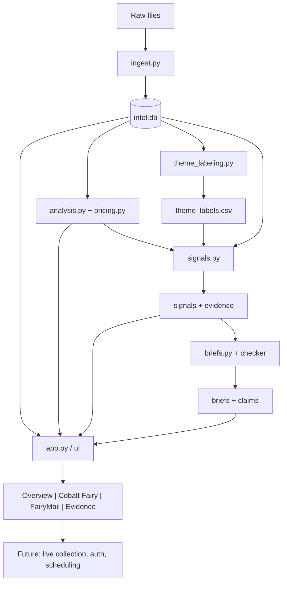

# Cobalt Fairy Intelligence Hub

Read-only prototype for Cobalt Fairy and FairyMail. It joins K-lytics market
data, CF catalogue/performance data, and FairyMail pricing plus public social
posts, and shows signals with their evidence. AI runs in batch; the dashboard
never calls it.

## Run

```powershell
python -m venv .venv
.\.venv\Scripts\Activate.ps1
.\.venv\Scripts\python.exe -m pip install -r requirements.txt
Copy-Item .env.example .env
.\.venv\Scripts\python.exe -m streamlit run app.py
```

`data/intel.db` is included, so no API key is needed. To rebuild:

```powershell
.\.venv\Scripts\python.exe ingest.py
.\.venv\Scripts\python.exe theme_labeling.py   # labels new posts; needs DEEPSEEK_API_KEY
.\.venv\Scripts\python.exe signals.py
.\.venv\Scripts\python.exe briefs.py           # needs DEEPSEEK_API_KEY
```

`theme_labeling.py` skips posts that already have labels; pass `--relabel` to
redo every post. Without a key, stop after `signals.py`; the included labels and
database already contain the AI output.

```powershell
.\.venv\Scripts\python.exe -m unittest discover -s tests -v
.\.venv\Scripts\python.exe demo_checker.py
```

## Architecture



`ingest.py` loads and validates the raw files. `analysis.py` and `pricing.py`
do the deterministic comparisons. `signals.py` applies fixed thresholds and
writes evidence. `theme_labeling.py` and `briefs.py` are the only AI steps. The
UI only reads SQLite.

## What to look at

- **CF vs market:** Regency `+1.6%` vs market `-7.0%`; Scottish/Highlander
  `-21.1%` vs `-19.0%` with a `+94.5%` price gap.
- **Pricing:** MailerLite renamed two plans and raised 500-tier prices `20-25%`;
  ActiveCampaign Pro `+11.3%` at a matched tier.
- **Cross-source:** Mailchimp unchanged pricing alongside email/SMS, AI and
  peak-season themes; Brevo changes alongside customer data and product
  positioning; MailerLite changes alongside product positioning and
  community/events. Co-occurrence only.
- **Uncertainty:** 4 pricing claims are `inferential`; CF Western and Regency
  Collection are `insufficient` (1 title each).

## AI error handling

The brief checker rejects invented quotes, unknown evidence IDs, trend language
under insufficient evidence, and text that treats a renamed plan as a separate
current plan. The real run produced 107 verified, 4 inferential, and 0
unsupported claims. `demo_checker.py` demonstrates all rejection paths against
the real database (8/8 cases). Details are in `IMPLEMENTATION_NOTE.md`.

## AI conversation / working record

Raw exports of the agent sessions used during the build are in
[`ai_conversations/`](ai_conversations/README.md), with a short index of what
each session covered.

## Caveats

- Social: 128 public posts (11 Facebook, 117 LinkedIn), sourced directly from
  the companies' public pages. Coverage is partial; some LinkedIn dates are
  approximate where the page showed relative age, and permalinks were not
  retained. Instagram was unavailable. The per-brand captures in
  `data/linkedin_*_posts.csv` are merged into `data/social_posts.csv`.
- K-lytics covers April and May 2025. CF commercial values are synthetic.
- Pricing baseline is September 2025; current captures are November 2026.
- Thresholds: 3 posts per theme, confidence 0.5, 5 same-title observations.

See `IMPLEMENTATION_NOTE.md` for decisions and limits.
