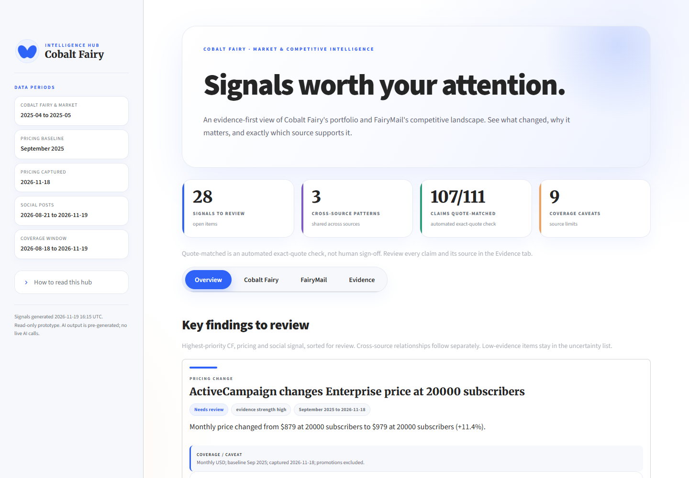
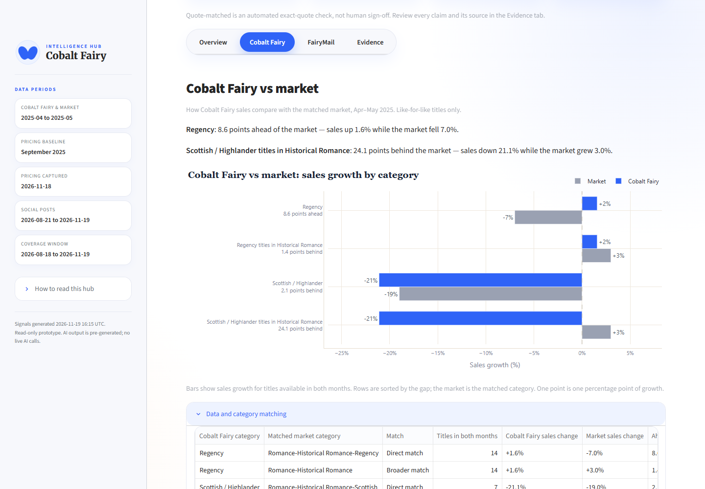
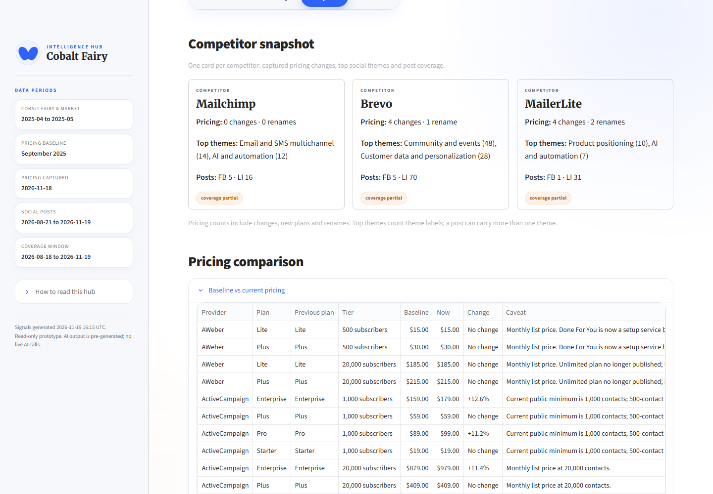
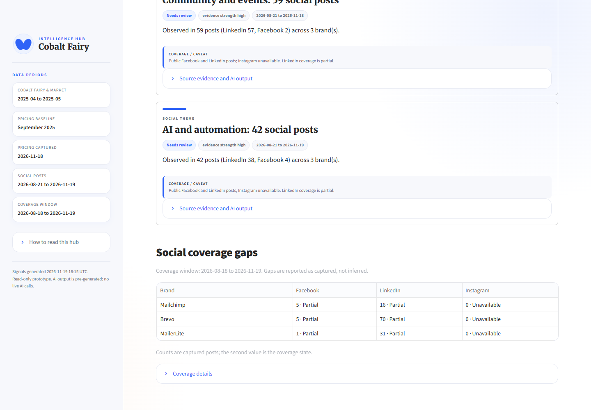
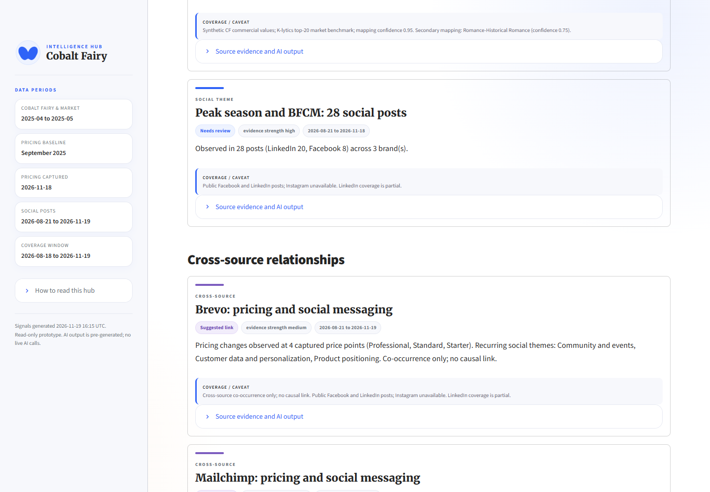
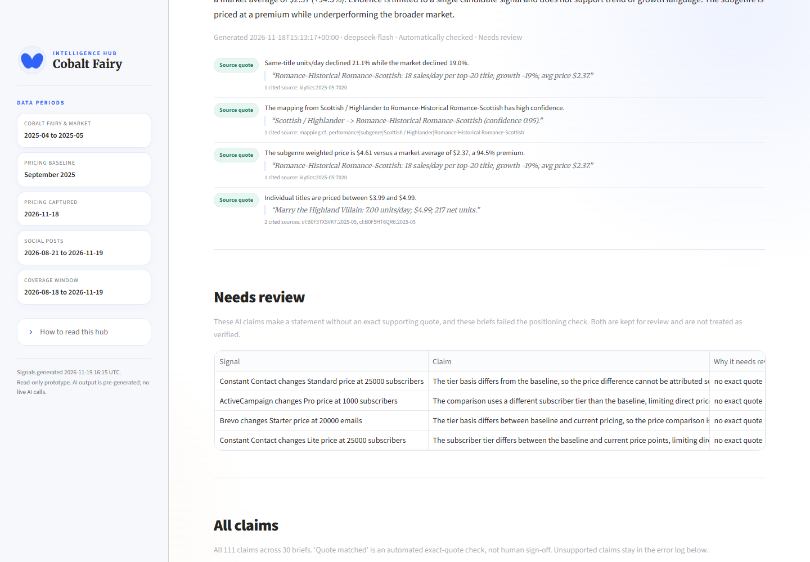
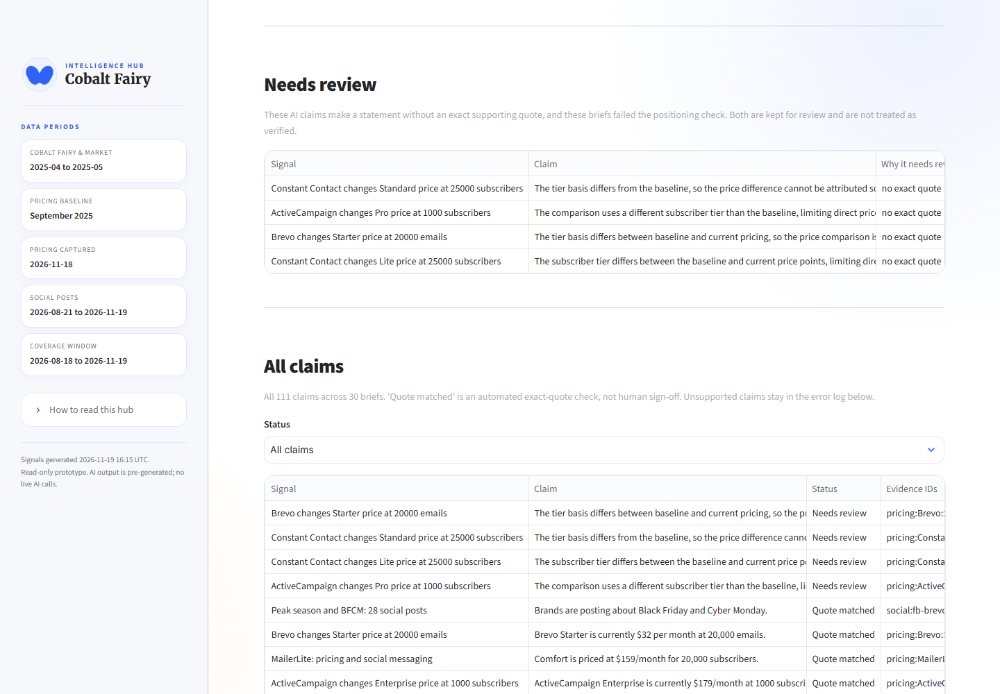

# Example intelligence outputs

Screenshots captured from the local real-data run on 2026-11-19. They show the implemented prototype, not synthetic social data.

## 1. Overview

The dashboard summarises the run: 28 signals to review, 3 cross-source patterns, 107 of 111 claims quote-matched, and 9 coverage caveats. The first key finding is a pricing change, with its review status and caveat visible.

## 2. Cobalt Fairy market vs portfolio

This compares CF's same-title sales change with the matched K-lytics market. Regency is ahead of the market. The Scottish and Highlander comparison is shown through both the direct and broader mappings: the direct match is -21.1% vs -19.0%, while the broader Historical Romance match is +3.0%. The app exposes both because category mappings are judgement calls. Mapping confidence and title counts are shown in the expander. Western and Regency Collection stay insufficient because they have too few same-title observations.

## 3. FairyMail pricing

The pricing view covers eight competitors and keeps the caveats visible. MailerLite's renamed plans and price changes, ActiveCampaign's matched-tier changes, and the cases where the current tier differs from the September 2025 baseline are all shown. Mismatched tiers are `inferential`, not clean like-for-like price changes.

## 4. FairyMail social coverage

The capture contains 128 public posts: 11 from Facebook and 117 from LinkedIn. Coverage is partial: Instagram was unavailable, some LinkedIn dates are approximate, and permalinks were not retained. Social themes require at least three posts, and the coverage table reports gaps rather than filling them in.

## 5. Cross-source relationship

This shows pricing and social messaging together. Brevo has pricing changes alongside recurring community/events, customer-data, and product-positioning themes. Mailchimp and MailerLite are shown on the same screen. The finding is co-occurrence only; the app does not claim causality.

## 6. AI uncertainty and review

The live AI run has four pricing claims with no exact supporting quote, so they are `inferential` and shown in the Needs review queue. They are not presented as verified. The claims concern pricing comparisons where the baseline and current tiers differ.

“Quote matched” is an automated exact-quote check, not human sign-off. The UI says this explicitly.

## 7. Claims and evidence IDs

The claims audit shows 111 claims across 30 briefs, their statuses, and their evidence IDs. This is the traceability layer: a reviewer can see which source IDs support a claim and inspect the corresponding evidence.

## 8. AI incorrect-output case

The required incorrect-AI case is the MailerLite Advanced → Power rename. A bad AI output would say Advanced remains a separate current plan. The checker rejects that claim, and if it appears in positioning, the brief is sent to `needs_review`.

Run `python demo_checker.py` to reproduce it. The captured output is in [demo_checker_output.txt](example_outputs/demo_checker_output.txt) and ends with `8/8 cases matched expectations`.

The checker covers invented quotes, unknown evidence IDs, trend language under insufficient evidence, and renamed-plan errors. It is rule-based and does not catch every possible bad sentence, so candidate and inferential output still requires human review.
